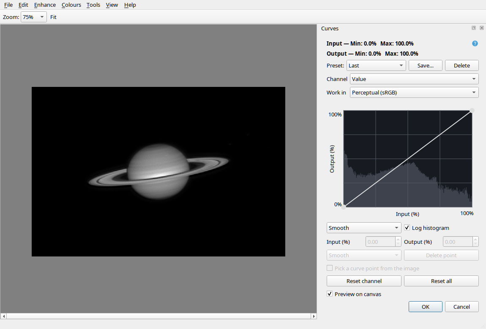

# Planetary Tools

Planetary Tools (PT) is a standalone desktop application for processing stacked
planetary images. Sharpen detail, reduce noise, correct colour, enhance moons,
align frames and create animations in one application.

**[Download the latest release](https://github.com/ckolivas/PlanetaryTools/releases/latest)**
 · **[Read the illustrated manual](docs/manual.md)**
 · **[Download the PDF manual](Planetary-Tools-Manual.pdf)**

## Get started

1. Download the build for your operating system from
   [Releases](https://github.com/ckolivas/PlanetaryTools/releases):
   - Linux: `planetary-tools-linux`
   - Windows: `planetary-tools-windows.exe`
   - Apple Silicon Mac (M1 or newer): `planetary-tools-macos-arm64.zip`
   - Intel Mac: `planetary-tools-macos-intel.zip`

   On macOS, double-click the ZIP to extract **Planetary Tools.app**, drag it
   to **Applications**, then double-click it in Finder. No Terminal command
   or separate Python installation is needed. On Linux, make the executable
   runnable if needed.
2. Launch PT and open a stacked image using **File > Open**, or drag one onto the main window.
3. Choose a tool from **Enhance** or **Colours**, compare its preview, then
   click **OK** to apply it.
4. Use **File > Save As** to save a processed copy in your chosen format and
   bit depth.

The Mac app is not Developer ID signed or notarized. If macOS blocks its first
launch, use **System Settings > Privacy & Security > Open Anyway** for the app
downloaded from this project's release page. See [Apple's opening instructions](https://support.apple.com/102445).

Older releases may still offer the bare `planetary-tools-macos` executable;
the Finder instructions above apply to the ZIP releases.

The standalone binaries include the Python runtime and application dependencies.
MP4 export and motion interpolation use bundled FFmpeg libraries through PyAV;
a separate FFmpeg executable is not required.

The manual covers every tool with screenshots, including the
[author's suggested sharpening workflow](docs/manual.md#authors-sharpening-workflow)
for one-shot colour images.

## Tools

- **Sharpen and denoise:** Wavelet Sharpen, Adaptive Deconvolution, Wavelet
  Denoise and post-sharpening FFT Denoise with automatic starting settings.
- **Planet and moons:** Moon Enhance, Deglow and Merge Wavelet Detail.
- **Colour:** Align RGB, camera colour-correction presets, Curves, Levels,
  Saturation & Vibrance, Extract Component, and RGB composition/decomposition.
- **Geometry:** scale, rotate, flip, crop and expand the image canvas.
- **Presentation:** Caption with system fonts, six placements, named web colours
  and remembered text/style settings.
- **Sequences:** Derotate/Align, batch processing and animation with optional
  timestamp-based motion interpolation. Export GIF, APNG, WebP or MP4.

Processing uses floating-point linear image data. Tools provide previews,
operation-labelled undo/redo and reusable presets where applicable. Undock tool
panels and resize their graphs for finer adjustments; PT remembers each tool's
floating size. See [the workspace guide](docs/manual.md#the-pt-workspace).

## Development

The application, tests, benchmarks and packaging configuration live in
[`planetary-app/`](planetary-app/). See the
[development guide](docs/development.md) for source setup, tests and standalone
build commands.

Documentation describes the current development tree. A published release may
not yet include every feature shown in the manual.

## License and author

Planetary Tools is free software under the GNU General Public License;
see [LICENSE](LICENSE) and [COPYING](COPYING).

Con Kolivas · <kernel@kolivas.org>
