# Planetary Tools illustrated user manual

[Project overview and downloads](../README.md) · [PDF edition](../Planetary-Tools-Manual.pdf) · [Development guide](development.md)

Revised **13 October 2026**. Covers working build **81fd691**, labelled **1.1.0** in the application, including features added after the published 1.1.0 release. Screenshots show the Linux Qt interface; window appearance can differ on other operating systems.

## Contents

- [The PT workspace](#the-pt-workspace)
- [Opening and saving images](#opening-and-saving-images)
- [Preview, presets and readouts](#preview-presets-and-readouts)
- [Undo and redo](#undo-and-redo)
- [Scale Image](#scale-image)
- [Rotate and flip](#rotate-and-flip)
- [Crop or expand the canvas](#crop-or-expand-the-canvas)
- [Wavelet Sharpen](#wavelet-sharpen)
- [Adaptive Deconvolution](#adaptive-deconvolution)
- [Wavelet Denoise](#wavelet-denoise)
- [FFT Denoise](#fft-denoise)
- [Moon Enhance](#moon-enhance)
- [Deglow](#deglow)
- [Merge Wavelet Detail](#merge-wavelet-detail)
- [Align RGB](#align-rgb)
- [Colour Correction Matrix](#colour-correction-matrix)
- [Curves](#curves)
- [Extract Component and Invert](#extract-component-and-invert)
- [Levels](#levels)
- [Saturation and Vibrance](#saturation-and-vibrance)
- [Stretch Contrast OKLab](#stretch-contrast-oklab)
- [RGB Compose from Files](#rgb-compose-from-files)
- [RGB Decompose to Files](#rgb-decompose-to-files)
- [Derotate/Align](#derotate-align)
- [Animate and motion interpolation](#animate-and-motion-interpolation)
- [Batch Processing](#batch-processing)
- [View, help and updates](#view-help-and-updates)
- [A practical processing sequence](#a-practical-processing-sequence)
- [The author's sharpening workflow](#authors-sharpening-workflow)

## The PT workspace

**Getting started**

Planetary Tools (PT) processes already-stacked planetary images. Open a still image, apply tools, compare the preview, and save a processed copy. The central canvas shows your image; the title includes its resolution.

### How to use

1. Open an image with File > Open. A colour image enables the RGB tools; some controls are unavailable for grayscale images.
2. Inspect the planet at View > Actual Size (100%). Use Zoom In/Out or Ctrl + mouse wheel to change magnification. Ordinary scrolling moves around a larger image.
3. Choose a processing tool from Enhance or Colours. Its controls appear in the filter dock while the canvas remains visible.
4. Use the dock title-bar buttons to undock or close a panel. Drag the floating panel's edges or corners to resize it; graphs expand for finer adjustments. Drag it back to an edge to reattach it. Hover over the buttons for help.

### Scope of this manual

Screenshots show the current working build on Linux. Window decoration and keyboard shortcuts can differ on Windows and macOS; the tool names and processing controls are shared.

### Example image

Most figures use the supplied Saturn image PT_4moons.png. Screenshot settings illustrate the controls, not a recommended recipe for every capture.

[Back to contents](#contents)

## Opening and saving images

You can drop one image from your file manager onto the main window to open it. PT uses the usual unsaved-change prompt. Drop multiple image files onto Batch, Derotate/Align, Animate or RGB Compose to add them; duplicate files are skipped. In RGB Compose, filenames determine channel assignment, or drop one file directly onto a Red, Green or Blue field to set that channel.

Drag rows within the Batch, Derotate/Align and Animate file lists to change their order. The alignment reference stays attached to the same image. Animate uses capture-time ordering instead when motion interpolation is enabled. File drops and reordering are unavailable while a batch, alignment or animation job is running.

**File > Open / Open Recent / Save / Save As**

PT remembers file-dialog locations and the last selected output format. Save As starts with the current image name and adjusts its extension to the selected format.

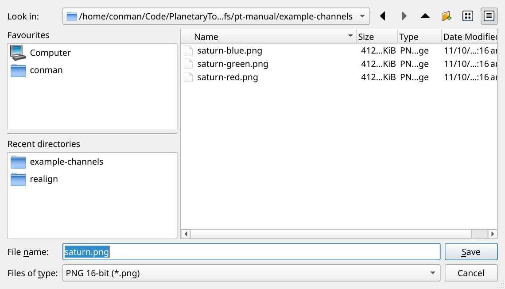

### How to use

1. Open a file, or choose it from Open Recent. In the file picker, use Favourites on the left and Recent directories below the separator.
2. Filter by an image type or All Images. All Files reveals every file; it does not make an unsupported format readable.
3. Choose Save As for a new output copy. Select the format/bit depth, check the destination and name, then save. Save writes to the current image path.

### Output choices

TIFF float32 retains floating-point working values. TIFF 16-bit and PNG 16-bit are useful for further processing. PNG 8-bit and JPEG suit delivery; JPEG is lossy. Avoid repeated JPEG editing.

### Working precision

The document is processed as floating-point linear data. A 16-bit export cannot preserve values outside its representable range. Keep a float TIFF if those values matter.

### Input formats

The picker lists TIFF, PNG, JPEG, FITS, BMP and WebP. Actual decoding depends on the format and installed/bundled image readers; the file extension alone is not a guarantee.

[Back to contents](#contents)

## Preview, presets and readouts

**Shared filter controls**

Most filter docks share preview, input/output readouts and preset controls. Treat the canvas as the final judge, supported by the measurements above the controls.

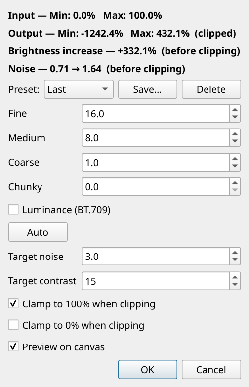

### How to use

1. Leave Preview on canvas enabled while adjusting the tool. Turn it off and on to compare against the image as it was when the tool opened.
2. Choose Default to start from the built-in settings, Last to recall the last accepted settings, or a named preset. Save creates or updates a reusable preset; reserved presets cannot be deleted.
3. Click OK to apply the current settings. Cancel discards the tool session. Turning preview off does not disable the operation when you click OK.

### Input and output

Minimum and maximum levels are shown as percentages. Enhance tools also show brightness increase and a noise score. Output statistics are measured before clipping; they can show values below 0% or above 100%.

### Clamping

Clamp to 100% proportionally scales RGB when highlights exceed 100%. Its companion Clamp to 0% also adjusts the black point during that scaling. These controls appear only where applicable.

### Noise score

This is a comparative estimate, not a universal quality grade. Inspect real detail, colour speckle and ringing as well as the number. Auto targets are starting constraints, not proof of an optimal result.

[Back to contents](#contents)

## Undo and redo

**Edit > Undo / Redo**

Undo and Redo include the name of the operation when it is available, for example Undo Levels or Redo FFT Denoise. The image and its grayscale/colour state move together through history.

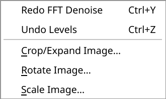

### How to use

1. Apply a tool with OK, then choose Edit > Undo to return to the preceding image.
2. Choose Redo to reapply that operation. Repeat to move through several processing steps.
3. Making a new edit after Undo starts a new branch and clears the abandoned redo steps. Opening another image clears the current document history.

### Shortcuts

The Edit menu displays the shortcuts used on your platform. Common mappings are Ctrl+Z for Undo and Ctrl+Shift+Z or Ctrl+Y for Redo.

### What history covers

History tracks in-memory image edits, not files already written by Save, batch processing, alignment or animation. Undo does not restore an overwritten disk file.

### Open tool sessions

Finish or cancel the active processing tool when prompted before switching operations or traversing history. Keep saved intermediate images for milestones beyond the in-memory history.

[Back to contents](#contents)

## Scale Image

**Edit > Scale Image**

Resize the image by percentage or exact pixel dimensions. Scaling changes the pixels in the document, whereas canvas zoom only changes how they are displayed.

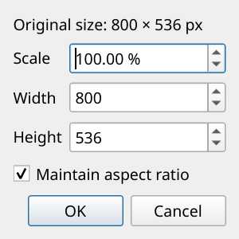

### How to use

1. Enter a Scale percentage, Width or Height. With Maintain aspect ratio enabled, the other dimension follows automatically.
2. Disable Maintain aspect ratio only when you intentionally need independent horizontal and vertical dimensions.
3. Confirm with OK and check the resolution in the title bar. Undo if the result is unsuitable.

### Practical use

Crop excess sky before enlarging an image for presentation. Upscaling does not recover detail missing from the capture. Downscaling may be useful for smaller animations or delivery.

### Precision

The dialog accepts fractional percentages. The resulting width and height are whole pixel dimensions. Save a new copy if the original resolution must remain available.

[Back to contents](#contents)

## Rotate and flip

**Edit > Rotate Image**

Rotate the frame or mirror it horizontally or vertically. Positive angles rotate counter-clockwise; the canvas normally expands to contain the rotated image.

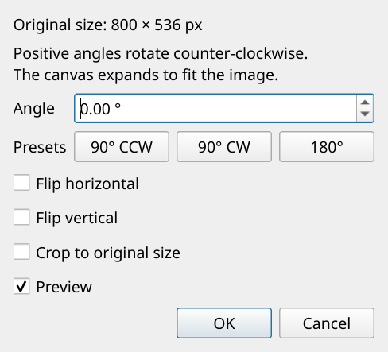

### How to use

1. Enter an angle or use the 90-degree and 180-degree preset buttons.
2. Select Flip horizontal and/or Flip vertical if needed. These are image mirrors, not changes to channel alignment.
3. Enable Preview to inspect the orientation. Choose Crop to original size if you want to retain the original canvas dimensions.
4. Click OK to apply, or Cancel to restore the starting image.

### Corners and empty areas

A general-angle rotation introduces empty border pixels. Cropping to the original dimensions can cut off parts of the rotated image. Inspect moons near the frame edge.

### Processing order

If several images need the same orientation, use a consistent operation or a batch step. Derotate/Align is the separate tool for estimating relative image rotation.

[Back to contents](#contents)

## Crop or expand the canvas

**Edit > Crop/Expand Image**

The dashed box on the canvas is the proposed output area. Crop removes pixels outside it; dimensions larger than the image expand the canvas with black pixels.

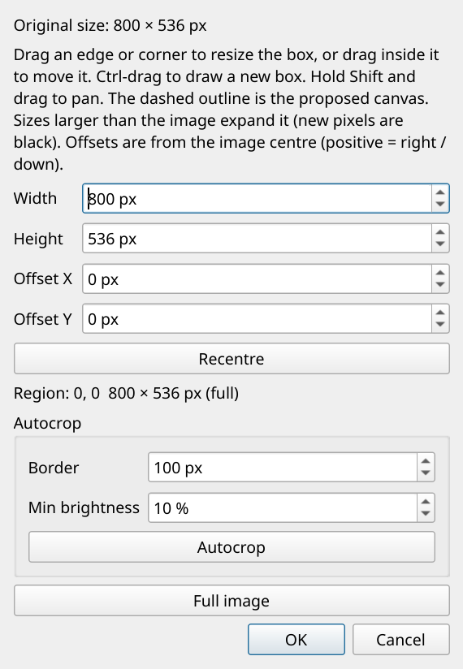

### How to use

1. Drag a side or corner of the box to resize it. Left-drag inside the box to move it.
2. Ctrl-drag to draw a fresh box. Hold Shift while dragging to pan instead of editing the selection.
3. For exact geometry, enter Width, Height and centre offsets. Positive X moves right; positive Y moves down. Recentre returns both offsets to zero.
4. Use Autocrop to estimate a box from image brightness, then adjust its border and minimum brightness threshold as needed. Confirm with OK.

### Check the outskirts

Autocrop can exclude faint moons or stars when they fall below the selected threshold. Include these deliberately if they are important.

### Expanded canvas

A larger box does not scale the planet. It adds space around the existing pixels; any portion of the original outside the chosen box is still lost on acceptance.

[Back to contents](#contents)

## Wavelet Sharpen

**Enhance > Wavelet Sharpen**

Increase contrast in detail at several spatial scales. Fine affects the smallest structures; Medium, Coarse and Chunky progressively affect larger structures.

### How to use

1. Inspect the planet at 100% zoom. Increase Fine gradually, then add Medium only as needed. Use Coarse and Chunky sparingly for broader structure.
2. Optionally enable Luminance (BT.709) to sharpen brightness detail and add that change back to RGB.
3. For a calculated starting point, set Target noise and Target contrast, then press Auto. Compare the result with preview off.
4. Check the limb, rings and small bright features before accepting. Follow with denoising if sharpening has amplified noise.

### Auto: Target noise

Determines how much of the different sharpening sliders Auto applies, according to how much grain is allowed in the final image. Normal values are 3-6.

### Auto: Target contrast

Limits oversharpening when the noise limit has not been reached. Normal values are 15-20 for first-stage sharpening before deconvolution, or 30-40 when Wavelet Sharpen is the sole sharpening endpoint. It limits brightness increase, rather than measuring local texture contrast.

### Luminance for poorer captures

Luminance processing can help poorer-quality captures, but can reduce saturation. The author restores it during final post-processing with Vibrance at 1.15-1.3.

### Too much sharpening

Bright/dark outlines at the limb, grainy cloud detail, rings around moons or coloured fringes are reasons to back off. FFT Denoise is intended for the post-sharpening stage.

[Back to contents](#contents)

## Adaptive Deconvolution

**Enhance > Adaptive Deconvolution**

Apply a sharpening/deconvolution step with an adjustable Amount. This can be useful as an alternative to, or a restrained final addition after, wavelet sharpening.

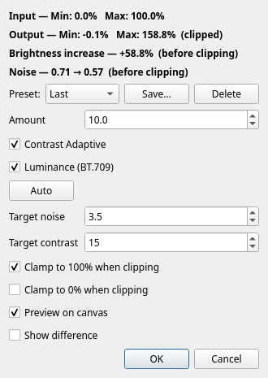

### How to use

1. Begin with a small Amount and inspect a region containing genuine detail and a bright edge.
2. Contrast Adaptive favours stronger local contrast and is often best reserved for a finalising sharpening step. Leave it off when preparing images for WinJUPOS derotation.
3. Optionally enable Luminance (BT.709). Use Auto with Target noise and Target contrast for an estimated amount.
4. Toggle preview and accept only if the added detail is useful rather than merely grainier.

### Amount and targets

Increasing Amount strengthens the effect. Auto searches for an amount without exceeding the selected noise and brightness-increase constraints.

### Finalising sharpening

For a single stack being finished as a final image, the author enables Contrast Adaptive after Wavelet Sharpen. Judge the combined result. The practical workflow section gives the suggested targets.

### Colour and clipping

Luminance mode can reduce colour noise at the cost of saturation. Watch the output levels and clamp controls when highlights become too bright.

[Back to contents](#contents)

## Wavelet Denoise

**Enhance > Wavelet Denoise**

Reduce noise at Fine, Medium and Coarse spatial scales. Unlike FFT Denoise, this tool uses separate scale amounts instead of a frequency cutoff curve.

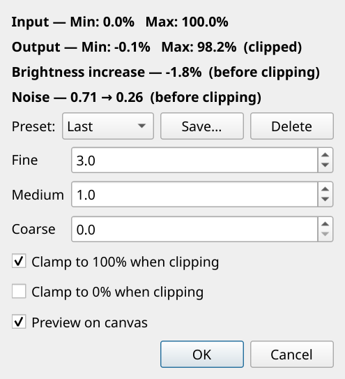

### How to use

1. After sharpening, raise Fine until the smallest unwanted texture is reduced.
2. Add Medium for broader grain, and Coarse only when noise remains at larger scales.
3. Compare with preview off at 100% zoom. Reduce the settings if belts, ring detail or tiny moons lose definition.
4. Save a preset for similar captures and click OK when satisfied.

### Fine detail versus noise

Both can occupy the same scales. A smoother image is not automatically a more accurate image.

### Choosing a denoiser

Wavelet Denoise offers direct scale-by-scale control. FFT Denoise shows the power spectrum and a smooth frequency transition. Try each on the same starting image using Undo; stacking strong denoise operations can soften the result.

### Readouts

Use the before/after noise score to support the visual comparison. Output measurements are taken before clipping correction.

[Back to contents](#contents)

## FFT Denoise

**Enhance > FFT Denoise**

Use this mainly after sharpening. A smooth radial frequency filter suppresses high-frequency noise; the graph shows input power in blue and predicted filtered power in red.

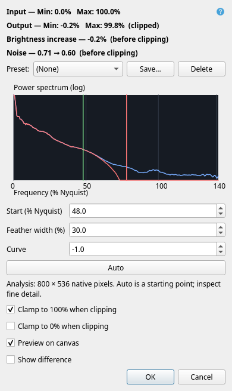

### How to use

1. Press Auto to estimate Start, Feather width and Curve from the current image. Auto considers negative Start values as well as nonnegative ones.
2. Fine-tune the numbers or drag the green Start and red feather-end markers. Any manual adjustment switches the saved settings to manual mode.
3. Enable Show removed signal to inspect the amplified difference. Strong recognizable edges in that view can indicate lost detail or ringing.
4. Toggle Preview on canvas, inspect the planet and small moons, then accept or revise the settings.

### Frequency units

100% Nyquist is 0.5 cycles per pixel. Diagonal frequencies extend to about 141.4%. Start accepts -141.4% to +141.4%. A negative Start begins attenuation before zero and can reduce even very low frequencies and overall brightness.

### Feather and Curve

Feather is the transition width, not its absolute endpoint. Negative Curve retains more of the transition; positive Curve suppresses more. Wider transitions generally reduce abrupt-cutoff ringing.

### Auto in batches

Saved Auto mode recalculates for each image after preceding batch steps. Auto is an editable estimate, not a guaranteed optimum. Spectrum analysis uses native pixels, with a bounded subject-centred crop for large images; filtering uses the full image.

[Back to contents](#contents)

## Moon Enhance

**Enhance > Moon Enhance**

Find and brighten compact moons outside the planet and ring protection area while leaving the planet and empty sky alone. The automatic margin estimates the surrounding glow.

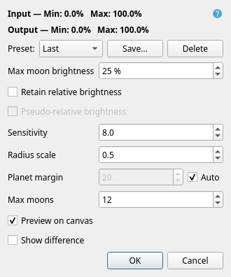

### How to use

1. Start with Planet margin Auto enabled. Auto follows the local glow around the disk and rings; the displayed number is its largest padding, rather than a uniform margin. If an inner moon is excluded, disable Auto and reduce the margin cautiously; manual values start at 1 pixel.
2. Adjust Sensitivity to detect the desired moons. Lower values admit fainter candidates but also more noise. Limit Max moons if false detections appear.
3. Set Max moon brightness. Enable Retain relative brightness to apply a common boost based on the brightest detected moon. With that enabled, Pseudo-relative brightness gives faint moons a stronger lift while keeping their brightness order: a moon at 1% of the brightest moon targets 10% instead. The maximum gain still limits very faint sources. Leave this off for strict brightness ratios.
4. Adjust Radius scale if the brightening footprint is too tight or too broad, then compare the result at 100% zoom.

### Relative brightness

With relative brightness off, each moon is boosted independently toward the target. With it on, the brightest moon sets the boost and fainter moons remain proportionally fainter.

### Limits

Moons already brighter than the target are not dimmed. Very faint detections can hit the gain limit. A real moon may be only one pixel across; inspect individual detections rather than expecting a large disk.

### Protection margin

A larger margin protects more halo and ring surroundings but may exclude a nearby moon. A smaller one can expose planetary glow to detection.

[Back to contents](#contents)

## Deglow

**Enhance > Deglow**

Reduce diffuse glow surrounding a bright planet while protecting its disk and rings. Compact single-pixel sources are excluded from the background estimate.

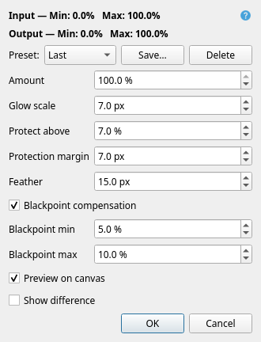

### How to use

1. Start with the default controls and compare preview on/off, especially in the sky immediately outside the rings.
2. Adjust Glow scale to follow the spatial size of the diffuse halo. Amount controls how much estimated glow is removed.
3. Lower Protect above or increase Protection margin to protect more of the subject. Feather controls the transition into full glow removal.
4. Inspect the planet edge and faint moons, then accept the result.

### Defaults

Amount 100%, Glow scale 7, Protect above 7%, Protection margin 7 pixels and Feather 15 pixels are the current defaults.

### Protection threshold

Protect above is relative to the subject peak above the sky, not an absolute file value. Lowering it includes dimmer parts of the disk and rings in the protected region.

### Good comparisons

Look for reduced smooth halo without dark trenches, an abrupt protection boundary, or lost ring detail. Reduce Amount if full subtraction is too strong.

[Back to contents](#contents)

## Merge Wavelet Detail

**Enhance > Merge Wavelet Detail**

Take fine spatial detail from a second image, such as an aligned near-infrared capture, while using the main colour image as the base.

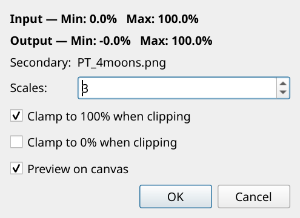

### How to use

1. Open the main colour image. Choose Merge Wavelet Detail and select the secondary image when prompted.
2. Use a secondary image of the same dimensions and aligned to the main image. Correct mismatches before merging.
3. Choose how many of the finest wavelet scales to transfer. Start with one scale and add more only if the result benefits.
4. Use Scales = 0 or preview off for comparison. Inspect for doubled edges and colour/detail inconsistencies before accepting.

### Scale count

0 leaves the main image unchanged. 1 uses fine detail; 2 adds medium; 3 adds coarse; 4 includes the fourth/coarsest detail band.

### What the screenshot shows

The secondary-file name is shown above the Scales control. This screenshot uses the sample image as a control demonstration, not as evidence of extra detail.

### Capture differences

Different wavelengths, seeing or capture times may show different real structure. This tool merges detail; it does not automatically make the observations physically equivalent.

[Back to contents](#contents)

## Align RGB

**Colours > Align RGB**

Align the red and blue channels to green using the same registration approach as Derotate/Align. Green remains the reference and the canvas dimensions remain fixed.

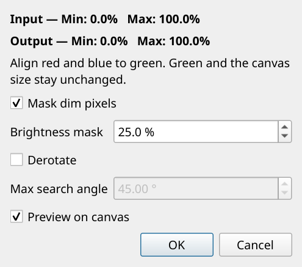

### How to use

1. Open the RGB image and choose Align RGB. Keep Mask dim pixels enabled initially.
2. Start with the 25% brightness mask. It excludes the bottom part of each channel's own minimum-to-maximum perceptual brightness range during estimation.
3. Use shift-only alignment by disabling Derotate, or enable it when rotation between channels is expected. Set a realistic Max search angle.
4. Inspect coloured fringes on the limb and rings with preview on/off. Apply when the channels agree more closely.

### Masking is for measurement

Dim pixels are ignored when estimating alignment; they are not removed from the resulting image.

### Seeing and glow

Soft or uneven glow can bias registration. Adjust the mask and inspect the sharp structures that should coincide.

### Choosing the tool

Align RGB corrects channels within one image. RGB Compose builds a colour image from channel files; Derotate/Align registers separate frames.

[Back to contents](#contents)

## Colour Correction Matrix

**Colours > Colour Correction Matrix**

Correct colour using a 3-by-3 matrix in linear RGB. PT includes built-in presets for correcting the colours of most popular planetary imaging cameras, as well as your own saved presets.

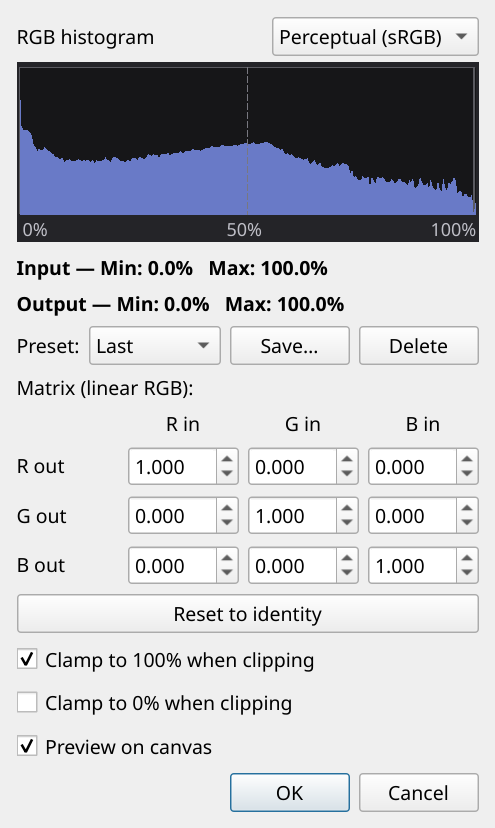

### How to use

1. Choose the built-in preset that matches your camera from Preset. If needed, use your own saved calibration or enter the nine matrix coefficients manually.
2. Use Reset to identity to return to no colour mixing: diagonal entries 1 and other entries 0.
3. Check the planet's colour and the per-channel histogram. Compare preview off before accepting.
4. Save a named preset for coefficients that you intend to reuse.

### Reading the matrix

The first row produces output red from input R, G and B. The second and third rows produce output green and blue. Off-diagonal values mix colour channels.

### Calibration matters

A matrix intended for one sensor or processing path is not automatically correct for another. Use a justified calibration rather than treating every preset as an artistic enhancement.

### Out-of-range values

Matrix coefficients can create negative values or highlights above 100%. Check the output statistics and clamp options before export.

[Back to contents](#contents)

## Curves

**Colours > Curves**

Map input brightness to output brightness with an editable curve. The horizontal axis is input and the vertical axis output; the diagonal is unchanged tone mapping.

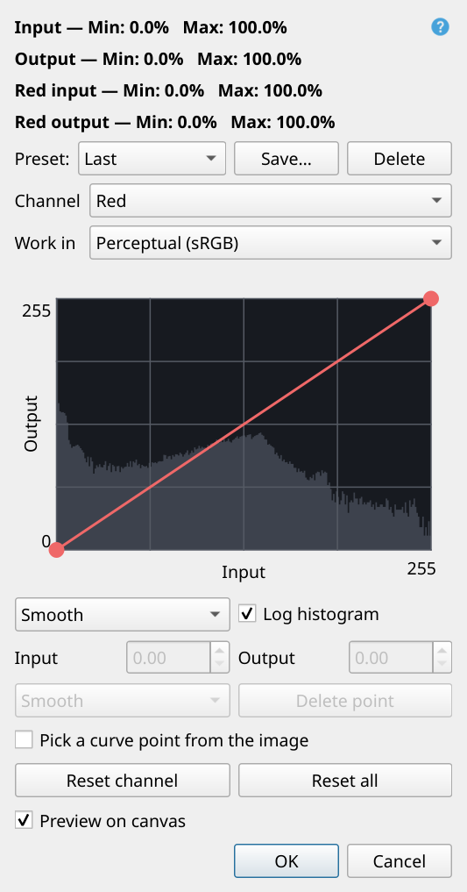

### How to use

1. Choose Value or an individual colour channel. Alpha is available when the image has an alpha channel. Value is applied after the individual RGB curves.
2. Click to add points and drag them. Select a point to edit its Input and Output numerically on a 0-255 coordinate scale; these coordinates do not reduce document bit depth.
3. Use Smooth or Freehand mode. Smooth/Corner changes the selected point type. Delete point or right-click removes a point; arrow keys move it and Shift increases the step.
4. Enable Pick a curve point from the image to sample a location on the canvas. Reset channel or Reset all restores straight curves.

### Working space

Perceptual (sRGB) is the familiar tonal editing view. Linear light works directly with linear brightness. Changing the working space changes the interpretation of the curve.

### Readouts and histogram

When a colour is selected, its input/output ranges appear alongside the overall ranges. Log histogram changes count display, not pixels. Linear display may cap very tall sky peaks to reveal other tones.

### Editing aim

A restrained S-curve raises midtone contrast. Avoid flattening the curve across important brightness ranges or crushing faint features into black.

[Back to contents](#contents)

## Extract Component and Invert

**Colours > Extract Component**

Create a grayscale representation from a colour component, or choose Invert to invert the original colour image. The help beside the controls follows the selected component.

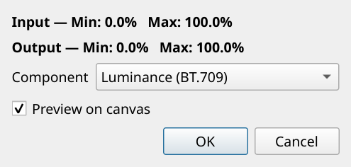

### How to use

1. Choose Luminance (BT.709), OKLab luminance, Average, Red, Green, Blue, Cyan, Magenta or Yellow to view a grayscale component.
2. Compare different components to find useful brightness detail or to inspect a noisy colour channel.
3. Choose Invert as its own component when you want an inverted image. It is not a switch that modifies another component.
4. Accept to replace the current image appearance, or cancel to retain it. Use Save As to keep a separate exported copy.

### Component meanings

BT.709 is weighted linear RGB luminance. Average gives equal weight to R, G and B. OKLab luminance uses perceptual lightness. Cyan averages G and B, Magenta R and B, and Yellow R and G.

### Invert

For a colour image, Invert computes one minus each RGB channel and retains colour. It is different from extracting inverted grayscale luminance.

### Separate channel files

Use RGB Decompose to Files when you want all three channels written to disk in one operation.

[Back to contents](#contents)

## Levels

**Colours > Levels**

Adjust black point, white point and midtones for Luminance or an individual RGB channel. Selecting a colour also shows its measured input/output ranges alongside the overall ranges.

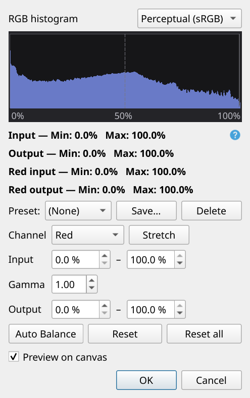

### How to use

1. Choose the channel. Adjust Input minimum and maximum to define the useful tonal range. Stretch sets the selected channel's input maximum to its measured peak.
2. Adjust Gamma for midtones: 1.00 is unchanged and values above 1 brighten midtones.
3. Set Output minimum and maximum to rescale or offset brightness. PT applies output mapping before input mapping and gamma, so recheck the combined result when changing both.
4. Use Auto Balance for an automatic RGB starting point, Reset for the current channel, or Reset all for every channel.
5. Clamp to 100% is on by default. Turn it off to retain highlights above 100% for further processing; this choice is saved with presets and batch steps.

### Auto Balance

Uses the 2% and 98% histogram percentiles for RGB input levels, then sets RGB output maxima to the lowest input maximum. It does not change the Luminance settings.

### Channel spaces

Luminance uses OKLab lightness with proportional RGB scaling. RGB adjustments work in perceptual sRGB values. The separate readouts are measured linear percentages, so do not equate them directly with every encoded control value.

### Preserve faint features

Raising the input black point can erase low-level moons or sky structure. Avoid relying on automatic limits without checking those areas.

[Back to contents](#contents)

## Saturation and Vibrance

**Colours > Saturation & Vibrance**

Adjust colour strength in OKLab. Both controls use 1.00 as the unchanged value. The two controls affect chroma differently.

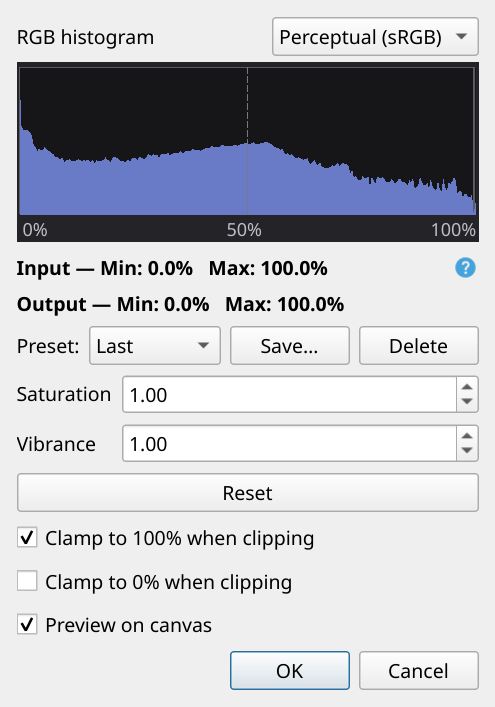

### How to use

1. Increase Saturation gently to strengthen colour overall, or lower it to reduce colour strength.
2. Use Vibrance to favour low-chroma areas more than already-saturated colours. Compare whether this gives a more natural result than Saturation alone.
3. Use Reset to restore both controls to 1.00. Check the image, histogram and output ranges before accepting.

### Neutral reference

Choose a familiar, well-exposed region of the planet as a visual reference. Excessive boosts can accentuate colour noise, atmospheric fringes and processing artifacts.

### Clipping

Strong colour changes can send individual channels out of range even when the overall image does not appear very bright. The clamp options can rescale the result, but they are not a substitute for checking colour balance.

### Tool order

Colour changes after sharpening and denoising may be easier to judge. Revisit them after a major Levels or Curves adjustment.

[Back to contents](#contents)

## Stretch Contrast OKLab

**Colours > Stretch Contrast OKLab**

Scale brightness through OKLab lightness while keeping RGB proportions. This is a quick overall brightness stretch, with one control: Stretch to.

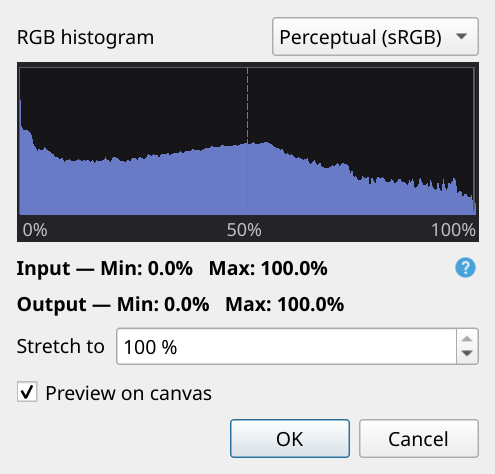

### How to use

1. Choose the desired target peak with Stretch to. 100% uses the full range; lower values target a lower peak.
2. Compare the preview with the original. Check that the chosen level does not make the planet or rings appear too harsh.
3. Accept the result, or use Levels/Curves instead if you need channel balance or a more selective tonal mapping.

### Lower targets

A target below the existing peak can contract brightness rather than brighten the image. A target of 0% produces black.

### Not a full tone editor

This control does not offer independent shadow, midtone and highlight shaping. Use Curves for local tonal control and Levels for black/white points and gamma.

### Histogram

The histogram display can be switched between perceptual and linear encoding where offered. This changes the display of counts, not the stored image.

[Back to contents](#contents)

## RGB Compose from Files

**Colours > RGB Compose from Files**

Combine two or three channel images into a colour image. Files can come from different directories, and channel assignment is guessed from names such as saturn_R or saturn-red.

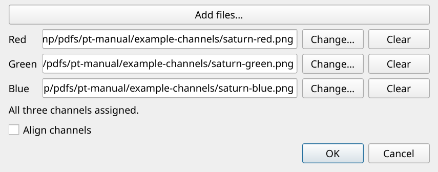

*Controls shown with the introductory line cropped from the figure.*

### How to use

1. Use Add files to collect candidate files, or use the Add/Change button beside each Red, Green and Blue row.
2. Check every assignment. The filename guess is a convenience, not a guarantee. Use Clear to remove an incorrect assignment.
3. Enable Align channels if the captured channels need shift alignment. It uses the shared alignment method with a 25% brightness mask.
4. Confirm with OK, inspect the composed result and save it with Save As.

### Inputs

Use channel images of matching dimensions. With only two channels, PT synthesizes the missing channel; this is an approximation, not an additional captured observation.

### Example screenshot

The three named sample files were decomposed from the example Saturn image for this manual. A real workflow may use separate filtered captures.

### Further alignment

The Compose option is shift-only. Use Align RGB afterwards for adjustable masking and rotation when required.

[Back to contents](#contents)

## RGB Decompose to Files

**Colours > RGB Decompose to Files**

Save the current colour image's red, green and blue components as three separate files without replacing the open image.

### How to use

1. Open the colour image and choose RGB Decompose to Files.
2. Choose an output folder, base filename, format and bit depth in the save dialog.
3. PT appends -red, -green and -blue before the extension. For example, saturn.png produces saturn-red.png, saturn-green.png and saturn-blue.png.
4. Check for existing files before confirming any overwrite prompts.

### Choose precision deliberately

Use TIFF float32 or a 16-bit format for channel files that will be processed or recomposed. Avoid JPEG when preserving channel detail matters.

### Picker screenshot

This is the shared save dialog used for image export. The decomposition command uses your chosen base name to create three outputs rather than a single image.

### Related operations

Extract Component changes the current image appearance to one component. RGB Compose from Files combines channel files back into a colour document.

[Back to contents](#contents)

## Derotate/Align

**Tools > Derotate/Align**

Register a set of still images to a chosen reference using translation and optional rotation. This corrects frame geometry; it does not undo planetary surface rotation in longitude.

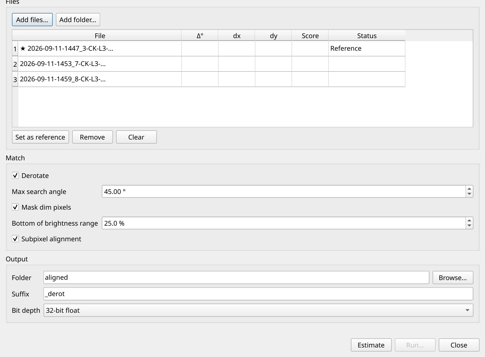

*Controls shown with the introductory line cropped from the figure.*

### How to use

1. Add files or folders, select a representative sharp frame and click Set as reference. Remove unsuitable inputs before estimating.
2. Keep Mask dim pixels on at 25% initially. Enable Derotate only if relative image rotation needs correction; set a realistic Max search angle.
3. Click Estimate and inspect the angle, dx, dy, score and status for each row. Widen table columns by dragging their dividers; double-click to fit.
4. Choose the output folder, suffix and bit depth. Keep Subpixel alignment enabled for fractional shifts. Click Run to write aligned copies.

### Mask definition

The threshold is minimum + percentage x (maximum - minimum), measured separately for each image in perceptual brightness. It excludes faint glow from measurement without deleting those pixels from the output.

### Inspect warnings

A solution at the search limit deserves review. Change the reference, mask or allowed rotation and estimate again if the planet or rings are visibly misplaced.

### Canvas and purpose

Different-sized inputs are centred on a canvas that fits the largest. This tool is not WinJUPOS central-meridian derotation and does not use observer location or sky coordinates.

[Back to contents](#contents)

## Animate and motion interpolation

**Tools > Animate**

Create GIF, animated PNG, WebP or MP4 from a sequence of still images. Align and finish the inputs first so brightness or position changes do not dominate the animation.

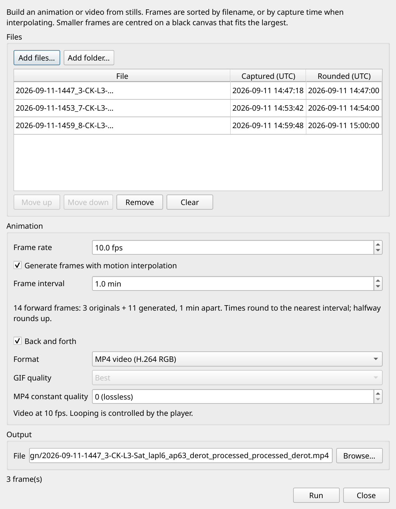

### How to use

1. Add files/folders and review the list. Without interpolation, inputs are initially sorted by filename; use Move up/down to adjust the sequence.
2. Set Frame rate for playback speed and choose Back and forth if you want the sequence to return in reverse without repeating its endpoints.
3. For missing times, enable Generate frames with motion interpolation. Confirm the Captured and Rounded UTC columns and choose Frame interval, normally 1 minute.
4. Choose a format and output path, then Run. Frame rate and interpolation settings are remembered.

### Timestamps

WinJUPOS and PVOL names are supported. Examples: 2026-09-11-1506_4-CK.png means 15:06:24 UTC; s2026-09-11_15-06-24_rgb_ck.png includes seconds directly.

### Rounding

Capture times round to the nearest interval, with halfway rounded up. Duplicate rounded times need a smaller interval or a file removed. Interpolation sorts by capture time, not your manual list order.

### Time versus playback

Frame interval is observation time between generated frames. Frame rate is playback speed. Interpolated frames are estimates, not additional observations.

### Output quality

MP4 CRF 0 is lossless for the converted 8-bit RGB animation frames; higher values reduce quality and size. It does not retain the original 16/32-bit precision. Playback needs H.264 RGB support. GIF has its own quality presets; bundled FFmpeg handles MP4 and interpolation.

[Back to contents](#contents)

## Batch Processing

**File > Batch Processing**

Apply an ordered pipeline to many images and write processed copies. Batch runs the filter steps in sequence for each input; it does not modify the open canvas document.

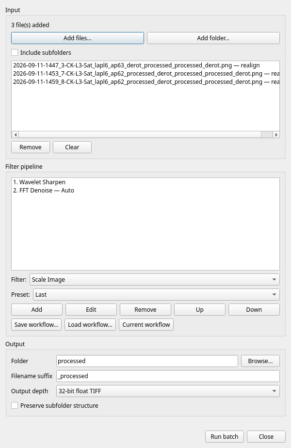

### How to use

1. Add files from any folders or Add folder. Set Include subfolders as needed and review the displayed input list. Remove unwanted files.
2. Choose a Filter and Preset, then Add it to the pipeline. Edit changes its parameters; Up/Down changes processing order; Remove deletes a step.
3. Place FFT Denoise after sharpening. Choose Auto in its batch editor, or use an Auto preset, to recalculate the denoise curve for every image after earlier steps.
4. Set output folder, filename suffix, depth and optional Preserve subfolder structure. Save workflow to reuse the pipeline and output options, then Run batch.

### Workflows and presets

A .ptbatch workflow describes a pipeline and output options. It is different from a single-tool preset. Load workflow restores the saved configuration; check the current inputs and destination before running.

### Auto versus manual

FFT Denoise Auto recalculates per image. Manually adjusted curves are fixed values. Wavelet Sharpen and Adaptive Deconvolution also offer batch Auto parameters; inspect their target constraints.

### Safe validation

First run a small representative subset and inspect sharp, soft and noisy frames. A good setting on one image may fail on another. Check the proposed output names and any overwrite prompts.

### Remembered choices

Input/output directories and output-depth preferences persist. The available pipeline filters are listed in the Filter selector; not every interactive menu command is a batch filter.

[Back to contents](#contents)

## View, help and updates

**View / Help**

Use view controls to inspect pixels and Help to identify the running version or check for a newer published release.

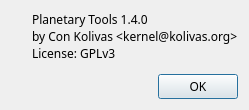

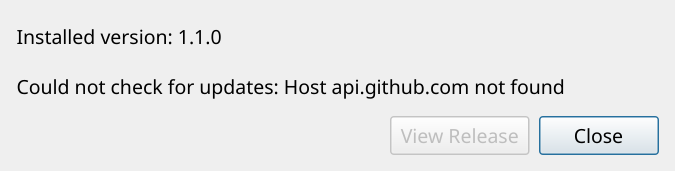

*The failed network check shown here does not establish whether a newer release is available.*

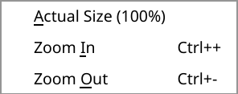

### How to use

1. Use View > Actual Size (100%) for one image pixel per canvas pixel. Zoom In and Zoom Out are display changes and do not resize the image.
2. Open Help > About Planetary Tools to see the version and author information.
3. Choose Help > Check for Updates to query GitHub releases. If a newer version is found, View Release opens its download page.
4. If checking fails, check network access and try again later. A failed request does not establish that the installed version is current.

### Manual build identification

This manual covers working build 81fd691, labelled 1.1.0 in the application. It includes changes made after the public 1.1.0 release, notably FFT Denoise and subsequent Auto improvements.

### Updating

The check opens release information; it does not silently replace the executable. Download the appropriate binary for your operating system and keep your images and presets.

### Dock layout

The filter dock contains its controls and any histogram. Use its title-bar button to detach it, then resize the floating panel to enlarge Curves, FFT Denoise or the RGB histogram. Graph positions continue to represent the same values at any size. Drag the panel to the left or right edge to reattach it at its compact width. Closing the panel cancels unapplied changes.

[Back to contents](#contents)

## A practical processing sequence

**Workflow and troubleshooting**

Use this sequence as a starting structure, and compare each change at useful image scale. The final section below gives the author's usual sharpening workflow for one-shot colour images.

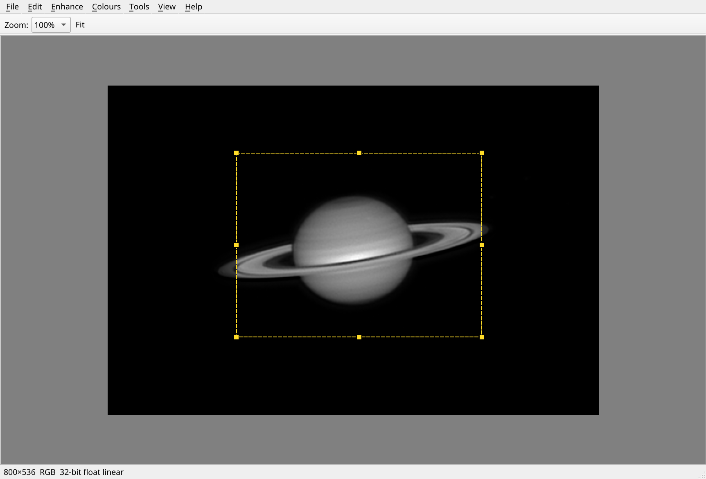

### How to use

1. Open a stacked image and save a working copy. Crop or orient it as required, preserving faint objects you want to keep.
2. Correct channel misregistration with Align RGB if needed. Apply restrained Wavelet Sharpen or Adaptive Deconvolution.
3. Use FFT Denoise after sharpening, or try Wavelet Denoise. Inspect the limb, ring edges, belts and tiny moons before accepting.
4. Refine Levels/Curves, colour and saturation. Use Deglow and Moon Enhance when appropriate, then export at the needed precision.

### Ringing or soft detail

Reduce sharpening, revise the denoise Start/Feather/Curve, and compare the removed-signal view. Do not chase the lowest noise score.

### Misalignment

Try a sharper reference, the default 25% min/max brightness mask, and shift-only registration where rotation is unnecessary. Inspect every result in a sequence.

### Missing moon or clipped highlight

Check crop bounds, Moon Enhance margin and sensitivity, and tone/clamp settings. Use Undo to locate the operation that caused the change.

### Source and revision

Revised 13 October 2026 with the author's camera-preset and sharpening guidance. Screenshots remain actual Qt renders of build 81fd691.

[Back to contents](#contents)

## The author's sharpening workflow

The author's normal process for one-shot colour images uses Wavelet Sharpen first, followed by deconvolution. Choose the deconvolution mode according to whether the image will be derotated in WinJUPOS or finished as a single stack.

### Suggested process

1. In Wavelet Sharpen, set Target noise to 3-6 and Target contrast to 15, then press Auto. Choose a noise level appropriate to the capture quality.
2. In Adaptive Deconvolution, set Target noise 0.5-1.0 higher than the Wavelet Sharpen target, keep Target contrast at 15 and press Auto. For example, a wavelet target of 4 becomes 4.5-5 for deconvolution.
3. For images intended for WinJUPOS derotation, leave Contrast Adaptive off. For a single stack being finished as the final image, turn Contrast Adaptive on. Adaptive mode is often best saved for this finalising sharpening step.
4. For poorer-quality captures, use Luminance (BT.709) mode in the sharpening tools. During final post-processing, set Vibrance to 1.15-1.3 to restore saturation.

### Two stages, one contrast limit

This workflow uses a contrast target of 15 in both stages. The higher 30-40 wavelet contrast range is for Wavelet Sharpen used as the sole sharpening endpoint.

### Adjust to the capture

These are the author's usual starting ranges. Inspect grain, the limb, rings and small moons at 100% zoom, and reduce sharpening if the result becomes harsh.

[Back to contents](#contents)
